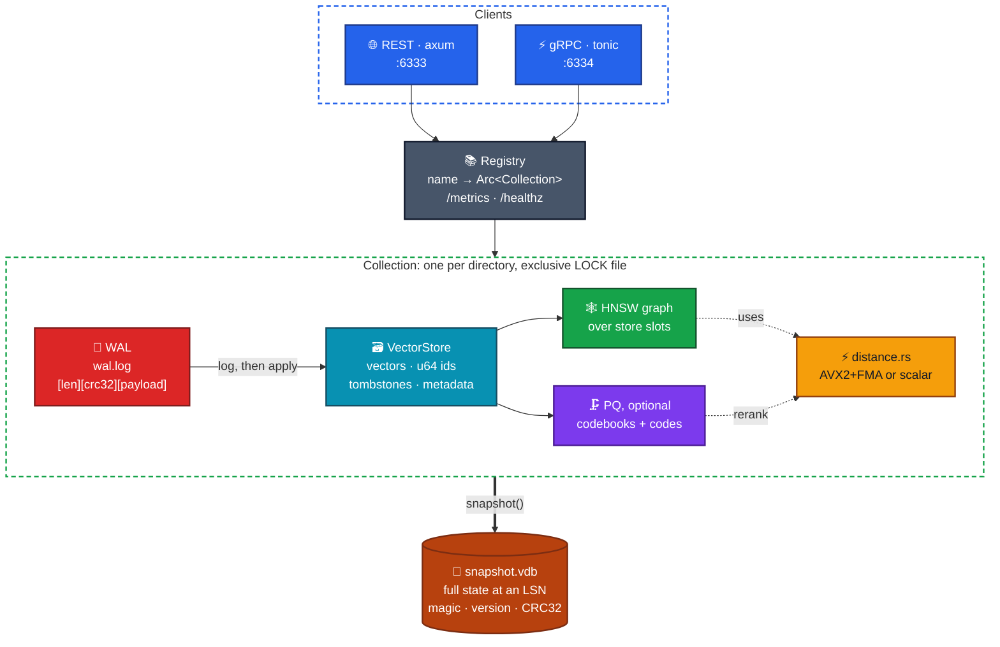
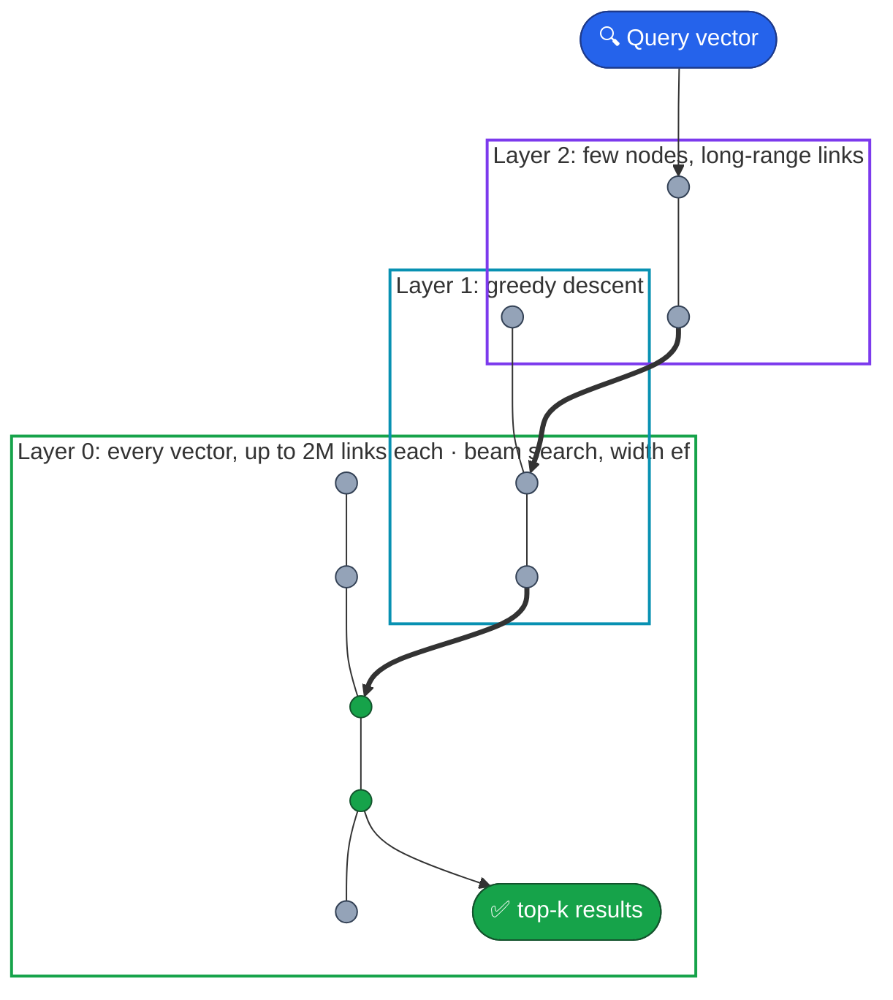
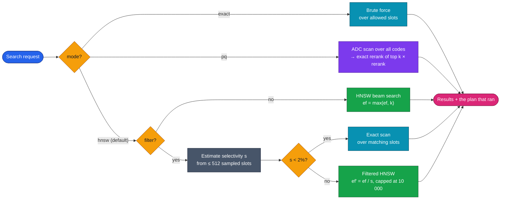
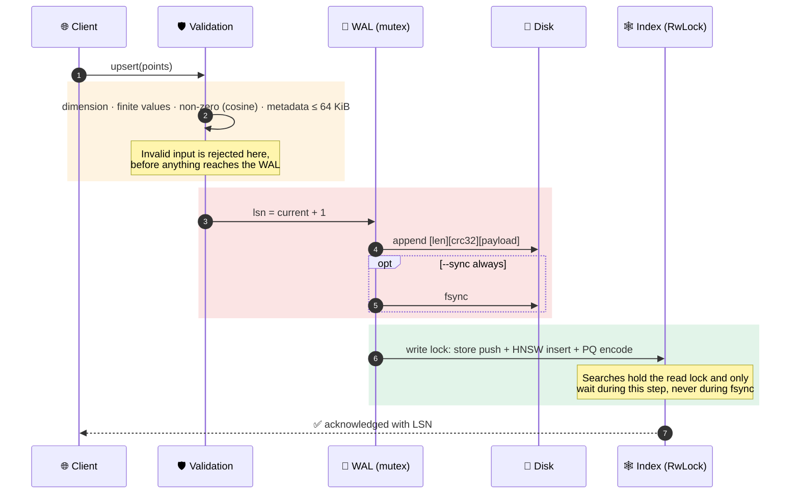
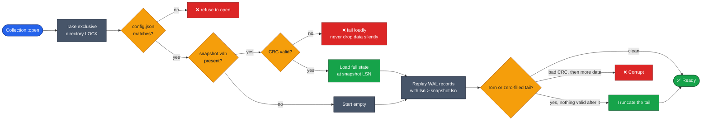
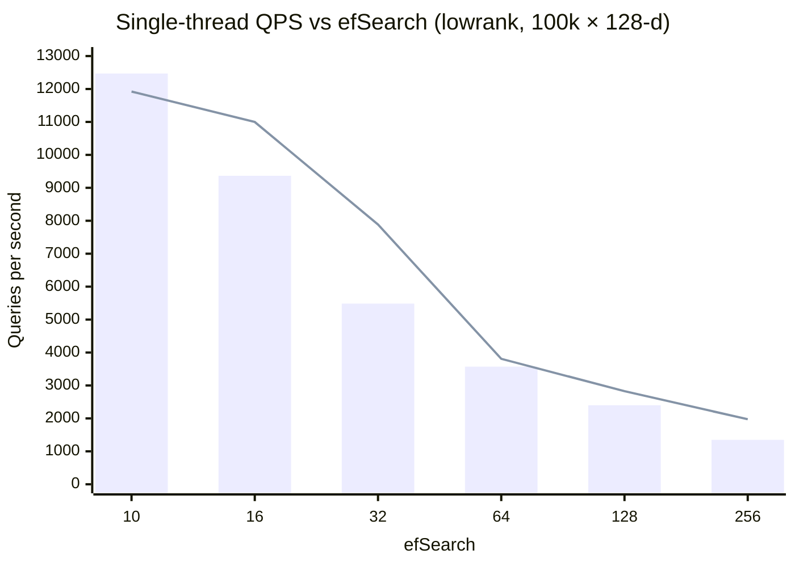
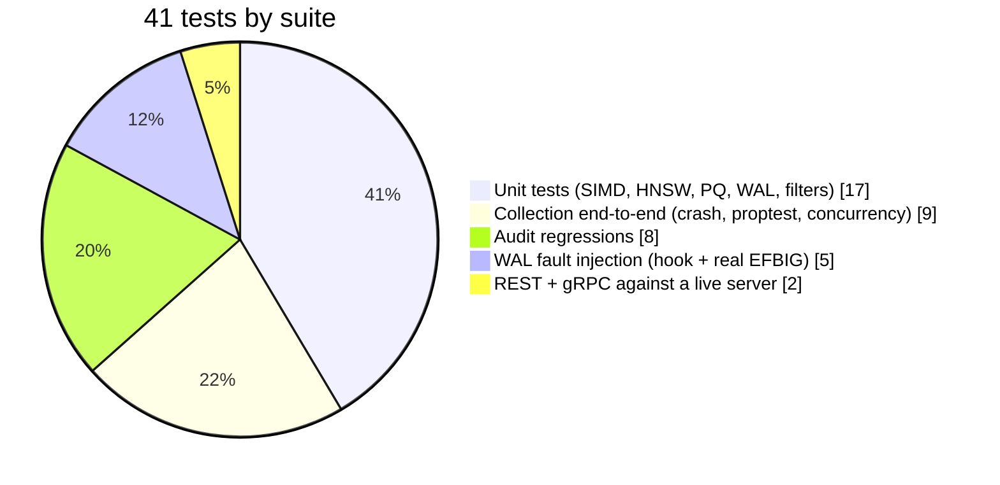

<div align="center">

# 🧭 VectorDB

### A persistent vector search engine in Rust, built from scratch

**HNSW · Product Quantization · AVX2/FMA SIMD · Filtered search · WAL + Snapshots · REST & gRPC**

<br/>


[**Architecture**](#%EF%B8%8F-architecture) · [**Benchmarks**](#-benchmarks) · [**Durability**](#-durability-wal--snapshots) · [**Quick start**](#-quick-start) · [**API**](#-api) · [**Audit**](#%EF%B8%8F-adversarial-audit) · [**Limitations**](#%EF%B8%8F-limitations)

</div>

---

## 📌 TL;DR

VectorDB is an approximate-nearest-neighbour (ANN) database written **from scratch in Rust**. It's what sits behind semantic search and RAG: you store embedding vectors with metadata, and query for the closest ones.

| What | How |
|---|---|
| 🕸️ **Index** | HNSW implemented from the paper: neighbour-selection heuristic, `keepPrunedConnections`, `2M` links on layer 0, graph invariant checker |
| ⚡ **Distance** | L2 / inner product / cosine with **AVX2 + FMA kernels**, picked at runtime, tested against a scalar reference at every length 0–300 |
| 🗜️ **Compression** | Product quantization (k-means++ / Lloyd, ADC lookup tables) with exact reranking |
| 🔎 **Filtering** | Metadata filters evaluated **inside** the beam search, plus a planner that switches to an exact scan below 2% selectivity |
| 💾 **Durability** | CRC-framed write-ahead log + atomic checksummed snapshots; tested by **crashing at every byte offset** of the WAL |
| 🌐 **Serving** | REST (axum) + gRPC (tonic), Prometheus `/metrics`, graceful shutdown, non-root Docker image |

> **Headline result:** on 100k × 128-d vectors the from-scratch HNSW matches or beats **FAISS `IndexHNSWFlat`** on recall at the same `M`, `efConstruction` and `efSearch`, at **0.63–1.05×** its single-query throughput.

---

## 🏗️ Architecture



<details>
<summary><b>📦 Module map</b></summary>

<br/>

| Module | Responsibility |
|---|---|
| [`distance.rs`](src/distance.rs) | Squared L2, negated inner product, cosine. Scalar reference + AVX2/FMA kernels picked via `is_x86_feature_detected!`. Cosine vectors are normalised on insert, so cosine becomes `1 − dot` |
| [`hnsw.rs`](src/hnsw.rs) | Random levels (`mL = 1/ln M`), greedy descent, beam search, the paper's neighbour heuristic, in-search filtering, `check_invariants`, brute-force `exact_search` |
| [`pq.rs`](src/pq.rs) | `m` sub-spaces × ≤ 256 centroids, seeded k-means++ + Lloyd, ADC tables, exact rerank of the top `k × rerank` |
| [`filter.rs`](src/filter.rs) | Filter algebra `eq · in · range · and · or · not` with depth, list and total-cost budgets |
| [`store.rs`](src/store.rs) | Dense `u32` slots, external `u64` ids, tombstones, metadata. Upsert = tombstone the old slot + append a new one |
| [`wal.rs`](src/wal.rs) | Append-only, CRC-framed log; torn tails truncated, mid-log corruption reported |
| [`snapshot.rs`](src/snapshot.rs) | temp file → fsync → rename → fsync directory. Every length field bounds-checked on decode |
| [`collection.rs`](src/collection.rs) | Write path, recovery, query planning, rebuild, PQ training, `check()` |
| [`server.rs`](src/server.rs) | REST + gRPC handlers, registry, Prometheus metrics |
| [`bin/bench.rs`](src/bin/bench.rs) | Benchmark harness: recall, QPS, latency percentiles, memory, filters, PQ, recovery |

</details>

---

## 🕸️ How a search finds its neighbours

HNSW is a stack of graphs that get sparser as you go up. A query drops in at the top, walks greedily toward the target, and drops a layer each time it can't get closer. Layer 0 holds every vector and gets a wide beam search.



### 🧠 The query planner

Filtered vector search is where naive engines break. Filter *after* a top-k search and you silently get back fewer than `k` results. Here the filter runs **inside** the traversal, and the planner decides when the graph isn't worth using at all.



Every response reports which plan ran, e.g. `"plan": "hnsw-filtered ef=128 (selectivity≈0.500)"`, so the planner's choices are visible.

---

## 💾 Durability: WAL + snapshots

### Write path: log first, then apply



### Recovery



**How it's tested, not just claimed:**
- 💥 **Crash at every WAL byte offset.** Every possible truncation must recover *exactly* the acknowledged prefix.
- 🧪 **Injected I/O faults.** A test hook fails the write (after a short write), the fsync, or the rollback itself. Acknowledged writes always survive, and a failed write is never applied.
- 🐧 **A real kernel error.** `RLIMIT_FSIZE` makes `write(2)` fail with a real EFBIG mid-record.
- 🧬 **Mutation check on the tests.** Removing the rollback truncate makes 3 of the fault tests fail ([log](docs/evidence/2026-10-15/wal_fault_mutation.log)), so the tests really depend on it.

---

## 📊 Benchmarks

**Setup:** 100,000 × 128-d vectors · 1,000 held-out queries · L2 · `M = 16`, `efConstruction = 200`, `k = 10` · 4-vCPU Xeon @ 2.8 GHz · `avx2+fma` kernel · compared against **FAISS `IndexHNSWFlat`** on identical vectors and ground truth. Full methodology: [`docs/benchmarks.md`](docs/benchmarks.md)

### Recall@10 vs efSearch (`lowrank` dataset)

| efSearch | **VectorDB recall** | FAISS recall | **VectorDB QPS** (1 thr) | FAISS QPS (1 thr) | p50 | p99 |
|:---:|:---:|:---:|:---:|:---:|:---:|:---:|
| 10 | **0.9390** | 0.9026 | **12,470** | 11,922 | 70 µs | 204 µs |
| 16 | **0.9771** | 0.9593 | 9,366 | 10,999 | 97 µs | 208 µs |
| 32 | **0.9959** | 0.9926 | 5,485 | 7,886 | 161 µs | 319 µs |
| 64 | **0.9999** | 0.9994 | 3,571 | 3,809 | 258 µs | 522 µs |
| 128 | **1.0000** | 1.0000 | 2,400 | 2,827 | 385 µs | 647 µs |
| 256 | **1.0000** | 1.0000 | 1,349 | 1,974 | 694 µs | 1,269 µs |


<sub>🟦 bars: VectorDB · line: FAISS IndexHNSWFlat, single-query mode. Both engines on the same host.</sub>

### Everything else at a glance

| Area | Result |
|---|---|
| 🔎 **Filtered search** | Recall **1.0000** at 50%, 10% and 1% selectivity (measured against exact *filtered* search) |
| 🗜️ **Product quantization** | `m = 32 × 256` centroids → codes + codebooks **3.3 MB vs 51.2 MB** of f32 vectors (**15.4×**). Recall@10 **0.9535** at rerank 4, **0.9999** at rerank 16 |
| 💾 **Snapshot** | 68.7 MB written in **0.995 s** |
| ♻️ **Recovery from snapshot** | **0.313 s**, search results identical before and after |
| 🏗️ **Build** | 2,003 inserts/s, single writer, each insert also WAL-logged |
| 🧱 **Memory** | HNSW graph ≈ **229 B/vector** |
| 🌀 **Hard dataset** (`mixture`, high intrinsic dimension) | Recall still matches or beats FAISS at every ef (0.9744 vs 0.9734 at ef = 64) |

> [!NOTE]
> PQ's 15.4× is **code** compression. With exact reranking the original vectors are kept too, so the whole database doesn't shrink 15×. Numbers come from one run each on a shared VM (about ±10% variance) and aren't comparable to results published on other hardware.

---

## 🛡️ Adversarial audit

After the server worked, an independent reviewer was asked to break it through the public API and **prove each defect with a failing test**. The reproductions were committed *before* any fix ([fail-before log](test-logs/audit-fail-before.txt) · [pass-after log](test-logs/cargo-test-after-audit.txt)).

| # | Severity | Defect found | Fix |
|:---:|:---:|---|---|
| 1 | 🔴 high | **Deadlock.** `stats()` took locks in the opposite order to writes; one `/metrics` call during an upsert hung the server | One global lock order, WAL → index |
| 2 | 🔴 high | **One request killed the process.** Unbounded PQ `rerank` tried to allocate 87 TB → SIGABRT | `rerank ≤ 1000`, `k × rerank ≤ 100 000` |
| 3 | 🟠 med-high | **Drop/create race lost acknowledged writes** | Directory renamed under the lock, deleted afterwards; crash leftovers cleaned on open |
| 4 | 🟡 medium | **Silent WAL truncation** on a corrupted mid-log length field | Only a real torn tail is truncated; otherwise the open fails with `Corrupt` |
| 5 | 🟢 low-med | `train_pq` with `max_train: 0` panicked → 500 | Validated, returns 422 |
| 6 | 🟢 low | Cosine rejected huge finite vectors because the norm overflowed | Scale by the largest magnitude before normalising |

Plus 8 suspected issues triaged: 7 fixed, 1 kept open and documented. Details: [`docs/audit.md`](docs/audit.md)

---

## ✅ Testing



| Highlight | Why it matters |
|---|---|
| **Crash at every WAL byte offset** | Proves recovery returns exactly the acknowledged prefix |
| **Proptest of the filtered-search contract** | Random data and filters: results always match exact filtered search and never contain deleted or non-matching ids |
| **SIMD vs scalar at every length 0..300** | Catches remainder-loop and alignment bugs in the AVX2 path |
| **HNSW `check_invariants`** | Validates graph structure after builds, recovery and rebuilds |
| **Live-server API tests** | Real axum + tonic on ephemeral ports; checks status codes (409/422/404/204), metrics and restart recovery |
| **Concurrent readers + writers** | Plus a 120 s anti-deadlock bound on `stats()` during upserts |

`cargo clippy --all-targets -- -D warnings` and `cargo fmt --check` are clean. More in [`docs/testing.md`](docs/testing.md).

---

## 🚀 Quick start

**Requirements:** Rust 1.89+ and Cargo

```bash
cargo test                       # 41 tests
cargo build --release
./target/release/vectordb serve --data ./data --http 127.0.0.1:6333 --grpc 127.0.0.1:6334 --sync always
```

In another terminal:

```bash
# Create a collection
curl -X PUT localhost:6333/collections/demo -H 'Content-Type: application/json' \
  -d '{"dim":3,"metric":"cosine","m":16,"ef_construction":200,"seed":42}'

# Insert points with metadata
curl -X PUT localhost:6333/collections/demo/points -H 'Content-Type: application/json' \
  -d '[{"id":1,"vector":[1,0,0],"metadata":{"lang":"en"}},{"id":2,"vector":[0,1,0],"metadata":{"lang":"de"}}]'

# Filtered nearest-neighbour search
curl -X POST localhost:6333/collections/demo/search -H 'Content-Type: application/json' \
  -d '{"vector":[0.9,0.1,0],"k":1,"filter":{"eq":["lang","en"]}}'
```

<details>
<summary><b>🐳 Docker</b></summary>

<br/>

```bash
scripts/docker_build.sh            # or: docker build -t vectordb .
docker run -p 6333:6333 -p 6334:6334 -v vdb-data:/data vectordb
scripts/docker_smoke.sh            # create, upsert, filtered search, restart, data survives
```

Multi-stage build, **156 MB** image, runs as unprivileged uid 10001, data on a volume. The smoke test checks that data survives `docker stop` and a fresh container on the same volume.

</details>

<details>
<summary><b>📈 Reproduce the benchmarks</b></summary>

<br/>

```bash
cargo build --release
./target/release/vdb-bench --out /tmp/lowrank --dataset lowrank
./target/release/vdb-bench --out /tmp/mixture --dataset mixture --skip-pq
pip install faiss-cpu numpy && python3 benchmarks/faiss_baseline.py /tmp/lowrank
```

</details>

<details>
<summary><b>🩺 Offline consistency check</b></summary>

<br/>

```bash
./target/release/vectordb check --data ./data   # stop the server first
```
Recovers every collection and re-runs graph invariants, store/graph/PQ size checks and live counts.

</details>

---

## 🔌 API

<table>
<tr><td valign="top" width="58%">

**REST** (`:6333`)

| Method | Path | Action |
|---|---|---|
| `PUT` | `/collections/:name` | Create |
| `GET` | `/collections/:name` | Stats |
| `DELETE` | `/collections/:name` | Drop |
| `GET` | `/collections` | List |
| `PUT` | `/collections/:name/points` | Upsert batch |
| `GET` / `DELETE` | `/collections/:name/points/:id` | Get / delete point |
| `POST` | `/collections/:name/search` | Search |
| `POST` | `/collections/:name/snapshot` | Snapshot + truncate WAL |
| `POST` | `/collections/:name/rebuild` | Compact tombstones |
| `POST` | `/collections/:name/train_pq` | Train PQ |
| `GET` | `/metrics` · `/healthz` | Prometheus · liveness |

</td><td valign="top">

**gRPC** (`:6334`, [`proto/vectordb.proto`](proto/vectordb.proto))

```protobuf
service VectorDb {
  rpc Upsert(UpsertRequest)
      returns (UpsertResponse);
  rpc Delete(DeleteRequest)
      returns (DeleteResponse);
  rpc Search(SearchRequest)
      returns (SearchResponse);
  rpc Stats(StatsRequest)
      returns (StatsResponse);
}
```

**Filter language**
```json
{"and": [
  {"eq": ["lang", "en"]},
  {"range": {"field": "year", "gte": 2020, "lte": 2026}},
  {"not": {"in": ["tag", ["spam"]]}}
]}
```

</td></tr>
</table>

---

## 🧠 Design decisions

Each one is written up as an ADR in [`docs/decisions/`](docs/decisions):

| ADR | Decision | Trade-off accepted |
|---|---|---|
| [0001](docs/decisions/0001-wal-plus-snapshot.md) | **WAL + whole-state snapshots** | Simple enough to test exhaustively, at the cost of 2× peak memory while snapshotting |
| [0002](docs/decisions/0002-filters-inside-beam-search.md) | **Filters inside the beam search**, exact fallback below 2% | Always returns `k` results; 2–10% selectivity can be slower than a scan |
| [0003](docs/decisions/0003-single-writer-lock.md) | **One writer per collection**, enforced by a directory lock | WAL can't be corrupted by two writers; ingest doesn't scale with cores |

### 🔐 Security boundary
Meant to run behind an authenticating proxy. Inside that boundary, no single request can crash the server, escape the data directory, or use unbounded resources: names restricted to `[a-z0-9_-]{1,64}`, 64 MiB message caps, bounded `k`, `ef`, `rerank` and filter cost, validation before logging, and CRC + bounds checks on every decode. See [`docs/security.md`](docs/security.md).

---

## ⚠️ Limitations

Stated plainly, from [`docs/limitations.md`](docs/limitations.md):

- **No auth, TLS, replication or sharding.** It runs behind a trusted boundary by design.
- **Single writer.** About 2k inserts/s at 128-d; searches run concurrently.
- **Maintenance blocks traffic.** `train_pq` and `rebuild` block searches; snapshots briefly double memory.
- **Fixed-threshold planner.** At 2–10% selectivity, filtered HNSW can be slower than a scan; metadata lookups go through a `BTreeMap`.
- **PQ without IVF or OPQ**, so PQ search is a full (scalar) ADC scan.
- **Synthetic benchmarks only.** No SIFT, GIST or real embedding datasets, and a single machine.
- **Partial I/O fault coverage.** No real device EIO or ENOSPC was produced.

### 🛣️ Next steps
- [ ] Benchmarks on SIFT1M / real embedding datasets
- [ ] Columnar metadata index + cost-based planner
- [ ] IVF coarse quantizer and SIMD ADC for PQ
- [ ] Incremental/segmented snapshots
- [ ] Parallel ingestion

---

## 📁 Repository layout

```text
VECTORDB/
├── src/
│   ├── distance.rs   ⚡ SIMD + scalar distance kernels
│   ├── hnsw.rs       🕸️ HNSW index + exact search
│   ├── pq.rs         🗜️ product quantization
│   ├── filter.rs     🔎 metadata filter algebra
│   ├── store.rs      🗃️ slots, ids, tombstones, metadata
│   ├── wal.rs        📝 write-ahead log
│   ├── snapshot.rs   💾 checksummed snapshots
│   ├── collection.rs 🧩 write path, recovery, planner
│   ├── server.rs     🌐 REST + gRPC + metrics
│   └── bin/bench.rs  📊 benchmark harness
├── proto/            📡 gRPC schema
├── tests/            ✅ integration, fault-injection, audit suites
├── benchmarks/       📈 FAISS baseline, results JSON, report renderer
├── docs/             📖 architecture, ADRs, audit, security, testing, evidence logs
└── Dockerfile        🐳 multi-stage, non-root
```

---

<div align="center">

**Built by [Siddhant Singh](https://github.com/siddhaantxsingh)**

</div>
