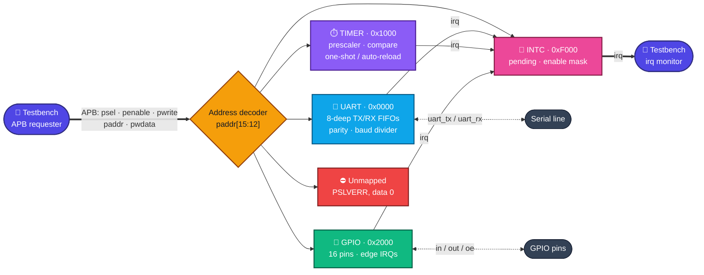
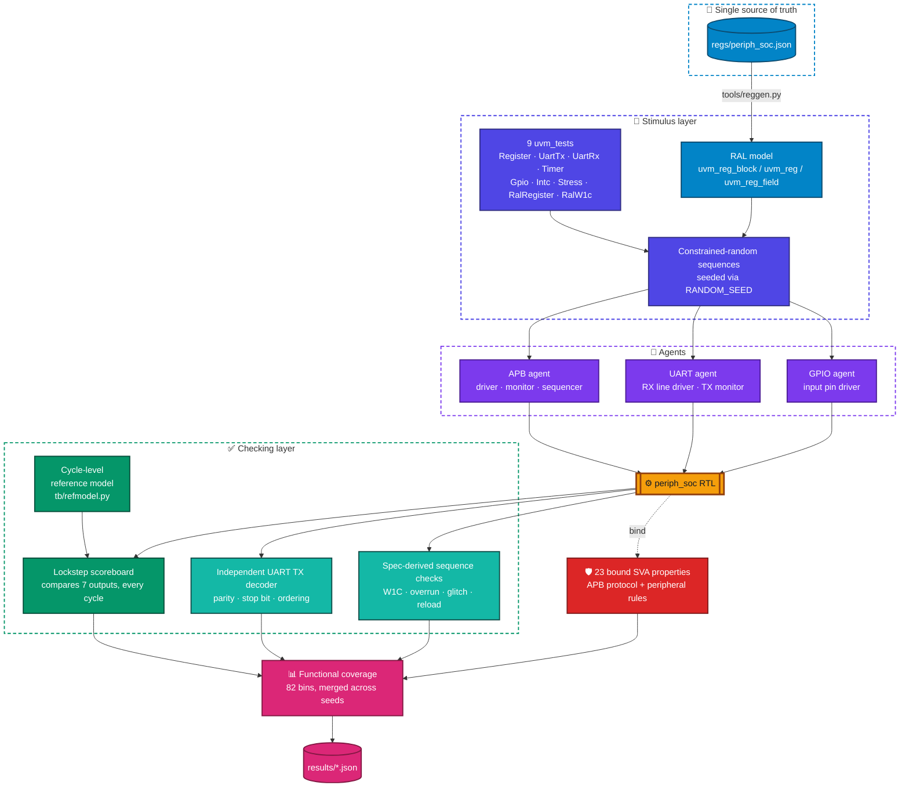
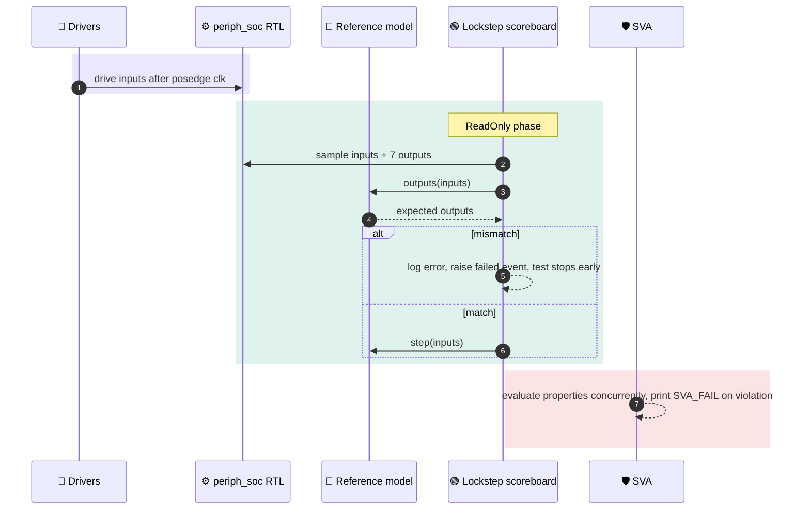
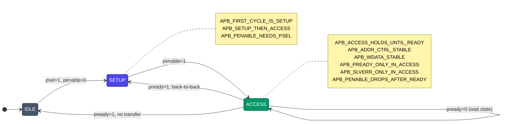
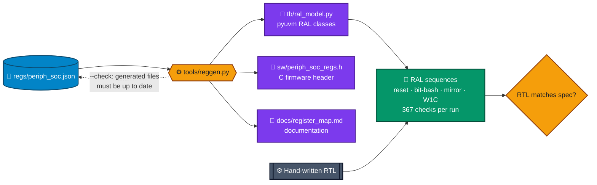
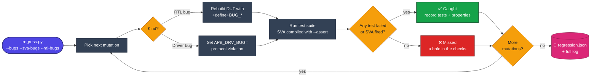
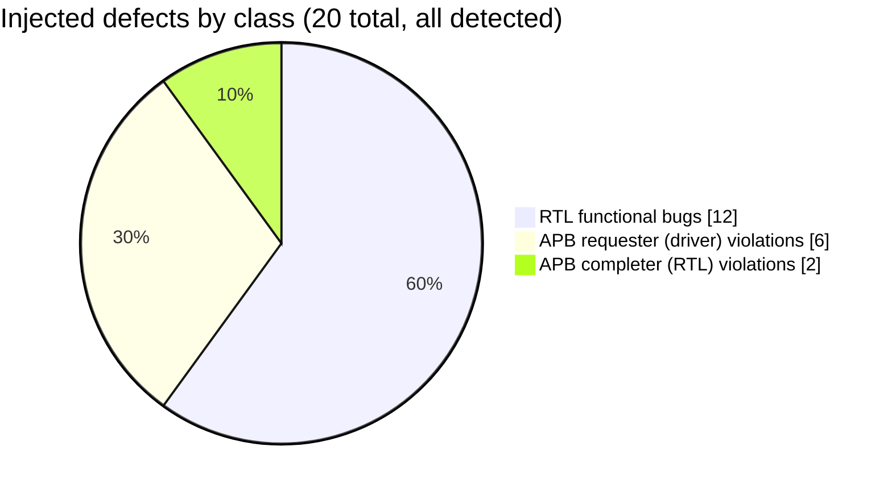
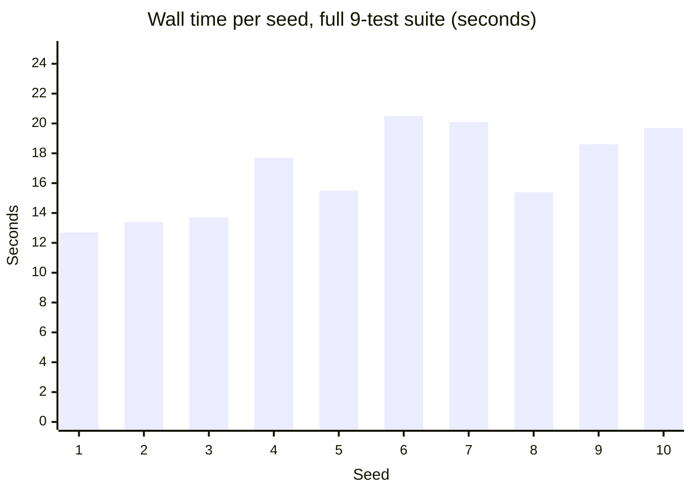
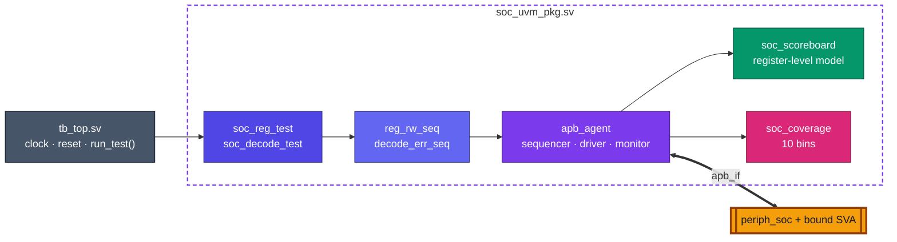

<div align="center">

# 🔬 APB SoC Verification

### UVM verification environment for an APB peripheral subsystem, tested with the bugs it should catch

*If you never inject a bug, you don't know that a passing regression means anything.*

<br/>


[**Results**](#-recorded-results) · [**Architecture**](#%EF%B8%8F-testbench-architecture) · [**Mutation testing**](#-mutation-testing-checking-the-checkers) · [**Quick start**](#-quick-start) · [**Limitations**](#%EF%B8%8F-limitations)

</div>

---

## 📌 TL;DR

A complete **UVM verification environment** for a multi-peripheral **APB subsystem** (UART, timer, GPIO, interrupt controller, address decoder). It is built in two ways:

| | **Main bench: pyuvm + cocotb** | **Native bench: SystemVerilog UVM** |
|---|---|---|
| Language | Python UVM (pyuvm 5.0) on cocotb 1.9.2 | IEEE 1800.2 SV-UVM (Accellera 2020.3.1) |
| Simulator | Verilator 5.020 | Verilator 5.052 (Docker) |
| Agents | APB master, UART serial, GPIO | APB master |
| Checking | Cycle-level lockstep reference model, independent UART decoder, directed spec checks, 23 SVA | Register-level scoreboard, SVA |
| Coverage | **82 functional bins** | 10 bins |
| RAL | ✅ generated from JSON | — |
| Tests | 9 | 2 |

**The main idea:** the environment is tested against **20 deliberately injected defects** (12 RTL functional bugs, 2 RTL protocol bugs, 6 APB driver protocol bugs). It catches all of them, and **every SVA property that can fire in 2-state simulation fires on the bug it targets.**

---

## 🧩 Design under test

`periph_soc` is a peripheral subsystem with one APB completer port. The testbench acts as the APB requester, standing in for a CPU.



<details>
<summary><b>📖 Memory map (generated from <code>regs/periph_soc.json</code>)</b></summary>

<br/>

| Block | Base | Registers | Notable behaviour |
|---|---|---|---|
| **UART** | `0x0000` | DATA, STATUS, CTRL, BAUD, IRQ_EN, IRQ_ST, RX_COUNT | One APB wait state per access · baud divider clamps to 4 · sticky W1C error flags |
| **TIMER** | `0x1000` | CTRL, PRESC, COMPARE, COUNT, STATUS | Counts every PRESC+1 clocks · one-shot or auto-reload · W1C match flag |
| **GPIO** | `0x2000` | OUT, OE, IN, RISE_EN, FALL_EN, IRQ_ST | Synchronised inputs · per-pin rise/fall interrupts · W1C edge flags |
| **INTC** | `0xF000` | PENDING, ENABLE | ORs the masked UART / timer / GPIO interrupts onto `irq` |
| *other* | — | — | `PSLVERR`, read data 0, no wait states |

Full field-level map: [`docs/register_map.md`](docs/register_map.md)

</details>

---

## 🏗️ Testbench architecture

The main bench is a standard UVM layering (sequences → sequencers → drivers → DUT → monitors → checkers) with **three kinds of checking**, so a mistake in one checker doesn't hide a bug.



### Three checkers that don't share the same assumptions

| Checker | What it does | Independent of the reference model? |
|---|---|:---:|
| 🟢 **Lockstep scoreboard** | A cycle-level Python model steps alongside the DUT and compares `pready`, `pslverr`, `uart_tx`, `gpio_out`, `gpio_oe`, `irq` **every cycle**, and `prdata` on every completed read | ❌ |
| 🟢 **UART TX decoder** | Samples the serial line mid-bit. Every byte accepted into the TX FIFO must appear in order, with correct parity and stop bit, and nothing else may appear | ✅ |
| 🟢 **Spec-derived sequence checks** | RX data equals the frames driven · parity/frame errors set on bad frames · overrun keeps the first 8 bytes · glitches rejected · W1C semantics · timer one-shot vs auto-reload | ✅ |
| 🔴 **SVA** | APB protocol and peripheral properties bound into the RTL, compiled with `--assert` on every run | ✅ |

The RTL and the reference model were written by the same author from the same spec, so a misreading shared by both would get past the lockstep scoreboard. The independent checkers are there to catch exactly that.

### What happens every clock cycle



---

## 🛡️ SystemVerilog Assertions

23 concurrent properties in [`sva/soc_sva.sv`](sva/soc_sva.sv), bound to the DUT by [`sva/sva_bind.sv`](sva/sva_bind.sv). The APB protocol properties follow the APB state machine:



| Group | Count | Examples |
|---|:---:|---|
| 🔵 APB protocol | 9 | the properties shown above |
| 📡 UART | 6 | `UART_TX_PARITY_CORRECT` · `UART_RX_SAMPLES_MID_BIT` · `UART_TX_FULL_AT_DEPTH` · `UART_BAUD_AT_LEAST_4` |
| ⏱️ Timer | 2 | `TIMER_TICK_EVERY_PRESC_PLUS_1` · `TIMER_MATCH_RESTARTS_AT_0` |
| 🔌 GPIO | 2 | `GPIO_W1C_CLEARS_ONLY_WRITTEN_BITS` · `GPIO_EDGE_ALWAYS_CAPTURED` |
| 🔔 Decoder / INTC | 2 | `SOC_DECODE_HOLE_ERRORS` · `SOC_IRQ_IS_MASKED_OR` |
| ⚪ No-X (4-state only) | 2 | `APB_NO_X_ON_REQUEST` · `SOC_NO_X_ON_OUTPUTS` |

> [!NOTE]
> **Built for the simulator I actually had.** A probe ([`verilator_5020_sva_support_probe.log`](docs/evidence/2026-10-15/verilator_5020_sva_support_probe.log)) showed that Verilator 5.020 rejects `##N`, named sequences, `[*N]` and `##[m:n]`. So every property uses only `|->`, `|=>`, `$past`, `$stable` and `$isunknown`, and multi-cycle rules are written as chains of one-cycle implications.

---

## 🗂️ Register Abstraction Layer: one spec, three outputs

The register map is written once, as JSON. Everything else is generated from it, and the RAL tests check the hand-written RTL against it.



**Working around pyuvm 5.0:** its `uvm_reg_predictor`, backdoor access and built-in register sequences raise `NotImplementedError`. [`tb/ral.py`](tb/ral.py) adds small replacements in the style of the UVM built-ins: auto-predict through the map, a "backdoor" that reads the RTL signals named in the JSON through cocotb handles, and hand-written reset, bit-bash, mirror and W1C sequences.

---

## 🧨 Mutation testing: checking the checkers

[`tools/regress.py`](tools/regress.py) rebuilds the DUT with each bug enabled, runs the whole suite, and records which tests failed and which SVA properties fired.





<details open>
<summary><b>🐞 Every functional bug and what caught it</b> (from <a href="results/2026-10-15/regression_full.log"><code>regression_full.log</code></a>)</summary>

<br/>

| Injected bug | Failure class | Caught by tests | SVA that fired |
|---|---|---|---|
| `BUG_UART_PARITY` | Data path | UartTx, Stress | `UART_TX_PARITY_CORRECT` |
| `BUG_UART_FIFO_DEPTH` | Off-by-one capacity | UartTx, Stress | `UART_TX_FULL_AT_DEPTH` |
| `BUG_RX_SAMPLE` | RX sampling point | UartRx, Stress, RalW1c | `UART_RX_SAMPLES_MID_BIT` |
| `BUG_UART_W1C` | Register semantics | UartRx, RalW1c | `UART_W1C_CLEARS_OVERRUN` |
| `BUG_UART_NOWAIT` | Protocol: missing wait state | 7 of 9 tests | `UART_FIRST_ACCESS_CYCLE_WAITS` |
| `BUG_UART_BAUD_CLAMP` | Register semantics | UartTx | `UART_BAUD_AT_LEAST_4` |
| `BUG_TIMER_RELOAD` | Counter behaviour | Timer | `TIMER_MATCH_RESTARTS_AT_0` |
| `BUG_TIMER_PRESC` | Counter behaviour | Intc | `TIMER_TICK_EVERY_PRESC_PLUS_1` |
| `BUG_GPIO_W1C` | W1C clears everything | Gpio, RalW1c | `GPIO_W1C_CLEARS_ONLY_WRITTEN_BITS` |
| `BUG_GPIO_EDGE_LOST` | Edge lost during W1C | Gpio | `GPIO_EDGE_ALWAYS_CAPTURED` |
| `BUG_INTC_MASK` | Interrupt routing | Gpio, Intc, Stress, RalW1c | `SOC_IRQ_IS_MASKED_OR` |
| `BUG_DECODE` | Address aliasing | Register | `SOC_DECODE_HOLE_ERRORS` |

**Each checker on its own:** with the lockstep scoreboard switched off (`LOCKSTEP=0`) and SVA non-fatal, `RalW1cTest` alone still catches both W1C bugs, e.g. `W1C of bit 2: uart_irq_st read 0x3c, mirror 0x38`.

</details>

---

## 📈 Recorded results

Run on 2026-10-15 with `python3 tools/regress.py --seeds 10 --bugs --bug-seeds 2 --sva-bugs --ral-bugs`

| Metric | Result | Scope |
|---|:---:|---|
| ✅ Seeded regression | **10 seeds × 9 tests = 90/90 pass** | Main pyuvm bench |
| 📊 Functional coverage | **82/82 bins (100%)** | Merged over 10 seeds; says nothing about whether the bin set itself is complete |
| 🧨 Functional RTL bugs | **12/12 caught** | The chosen mutation set |
| 🔵 Protocol bugs (driver + RTL) | **8/8 caught by SVA** | 6 requester + 2 completer violations |
| 🛡️ SVA properties firing on their target | **21/21 testable** | 2 no-X properties can't fail on 2-state Verilator |
| 🧹 SVA failures on clean RTL | **0** | All 10 seeds |
| 🗂️ RAL register checks | **367 per run** | Reset, bit-bash, mirror, W1C |
| ⚙️ Native SV-UVM | **UVM_ERROR 0 / UVM_FATAL 0**, 450 transfers checked | Verilator 5.052 + Accellera UVM 2020.3.1 |
| 🎯 Native SV-UVM, failing first | **UVM_ERROR 26** with `+define+BUG_DECODE` | Shows the SV scoreboard really detects the bug |


<sub>Measured on a shared 4-vCPU machine under load, so the spread is mostly noise from other jobs.</sub>

---

## ⚙️ The native SystemVerilog UVM bench

A second, smaller environment in [`sv_uvm/`](sv_uvm), written in standard IEEE 1800.2 SystemVerilog UVM so the same DUT runs on an industry-style flow.



| Test | Transfers checked | Mismatches | Coverage | UVM_ERROR | UVM_FATAL | SVA_FAIL |
|---|:---:|:---:|:---:|:---:|:---:|:---:|
| `soc_reg_test` | 200 | 0 | 9/10 | 0 | 0 | 0 |
| `soc_decode_test` | 250 | 0 | 10/10 | 0 | 0 | 0 |

Verilator 5.020 can't compile the UVM library, so this bench uses the official `verilator/verilator:v5.052` Docker image with pinned digests ([`docs/sv_uvm.md`](docs/sv_uvm.md)). Ready-to-run commands for **Xcelium, Questa, VCS and EDA Playground** are in [`docs/OWNER_ACTIONS.md`](docs/OWNER_ACTIONS.md).

---

## 🚀 Quick start

**Requirements:** Python 3, Make, a C++ toolchain, Verilator ≥ 5.020

```bash
# 1. Python environment
python3 -m venv .venv && source .venv/bin/activate
pip install -r tb/requirements.txt          # cocotb 1.9.2, pyuvm 5.0.0

# 2. Run the suite once (SVA compiled in by default)
(cd tb && make SIM=verilator)

# 3. Full regression: 10 seeds + every mutation campaign
python3 tools/regress.py --seeds 10 --bugs --sva-bugs --ral-bugs

# 4. Regenerate the RAL model, C header and register docs from JSON
python3 tools/reggen.py
```

<details>
<summary><b>🔧 More options</b></summary>

<br/>

```bash
# One test, one seed (pyuvm tests are picked with ONLY_TESTS, not TESTCASE)
(cd tb && ONLY_TESTS=UartRxTest RANDOM_SEED=7 make SIM=verilator)

# Build with an injected RTL bug (separate build dir so the clean build stays intact)
(cd tb && make SIM=verilator SIM_BUILD=sim_build_parity BUG_DEFINES=+define+BUG_UART_PARITY)

# Inject an APB protocol violation from the driver, SVA reported but not fatal
(cd tb && ONLY_TESTS=RegisterTest APB_DRV_BUG=addr_change SVA_FATAL=0 make SIM=verilator)

# Native SystemVerilog UVM bench (Verilator >= 5.036, Accellera uvm-core)
UVM_HOME=/path/to/uvm-core/src sv_uvm/run_verilator.sh out/
UVM_HOME=/path/to/uvm-core/src sv_uvm/run_verilator.sh out_bug/ +define+BUG_DECODE   # failing-first run
```

</details>

---

## 📁 Repository layout

```text
UVM-SOC-VERIFICATION/
├── rtl/            ⚙️  DUT: periph_soc top, apb_uart, apb_timer, apb_gpio (bugs behind `ifdef BUG_*)
├── tb/             🐍  pyuvm bench: agents, env, scoreboard, refmodel, sequences, RAL, tests
├── sva/            🛡️  SVA properties, bind file, Verilator SVA-support probe
├── sv_uvm/         🧱  native SystemVerilog UVM bench + Verilator run script
├── regs/           📜  periph_soc.json, the single register specification
├── tools/          🔧  reggen.py (code generator) · regress.py (regression + mutation runner)
├── sw/             💾  generated C register header for firmware
├── results/        📊  machine-readable regression outputs (JSON + full log)
└── docs/           📖  verification plan, requirements matrix, register map, limitations, evidence logs
```

| Start reading here | Why |
|---|---|
| [`tb/refmodel.py`](tb/refmodel.py) | Cycle-level reference model of the whole subsystem |
| [`tb/env.py`](tb/env.py) | Lockstep scoreboard, UART decoder, coverage collector, SVA counter |
| [`sva/soc_sva.sv`](sva/soc_sva.sv) | All 23 concurrent assertions |
| [`tools/regress.py`](tools/regress.py) | How the mutation campaigns run |
| [`docs/verification_plan.md`](docs/verification_plan.md) | Feature → stimulus → coverage bin mapping |
| [`docs/requirements.md`](docs/requirements.md) | Every claim tagged VERIFIED / UNVERIFIED / BLOCKED, with evidence |

---

## 🧠 Skills demonstrated

<table>
<tr>
<td width="50%" valign="top">

**Verification methodology**
- UVM component hierarchy and phasing
- Constrained-random stimulus with reproducible seeds
- Coverage-driven closure with merging across seeds
- Reference-model and lockstep scoreboarding
- Mutation testing to measure how good the checks are

</td>
<td width="50%" valign="top">

**Languages & tooling**
- SystemVerilog RTL, SVA, native SV-UVM
- Python: pyuvm, cocotb, code generation
- UVM RAL: reset, bit-bash, mirror, W1C sequences
- Verilator flows, Docker-pinned toolchains
- Regression automation with JSON reporting

</td>
</tr>
</table>

---

## ⚠️ Limitations

Every claim above is tied to a log in [`results/`](results/2026-10-15) or [`docs/evidence/`](docs/evidence/2026-10-15). What this project does **not** show:

- **No commercial simulator run.** Both benches are verified on Verilator only, and the two no-X assertions need a 4-state simulator to mean anything.
- **No formal proof.** The SVA are checked in simulation only.
- **The SV-UVM bench is deliberately small.** It uses `$urandom` instead of `randomize()` (Verilator 5.052 failed on inline constraints) and bin counters instead of covergroups. The 82-bin and RAL results belong to the pyuvm bench.
- **The model and the RTL share an author.** The independent checkers reduce the risk of a shared misreading but don't remove it.
- **No code coverage.** Line and toggle coverage weren't collected.
- **It's a peripheral subsystem, not a CPU SoC.** The testbench plays the role of the CPU.

Full list: [`docs/limitations.md`](docs/limitations.md)

### 🛣️ Next steps
- [ ] Run `sv_uvm/` on Xcelium / Questa / VCS and turn on the no-X properties
- [ ] Formal proof of the SVA set (Jasper / VC Formal / SymbiYosys)
- [ ] Covergroups and constrained `randomize()` in the native bench, once the simulator supports them
- [ ] A larger, automatically generated mutation set
- [ ] Line and toggle coverage alongside functional coverage

---

<div align="center">

**Built by [Siddhant Singh](https://github.com/siddhaantxsingh)** · B.Tech ECE (VLSI Design & Technology), MIT Manipal

<sub>MIT License · See <a href="LICENSE">LICENSE</a></sub>

</div>
