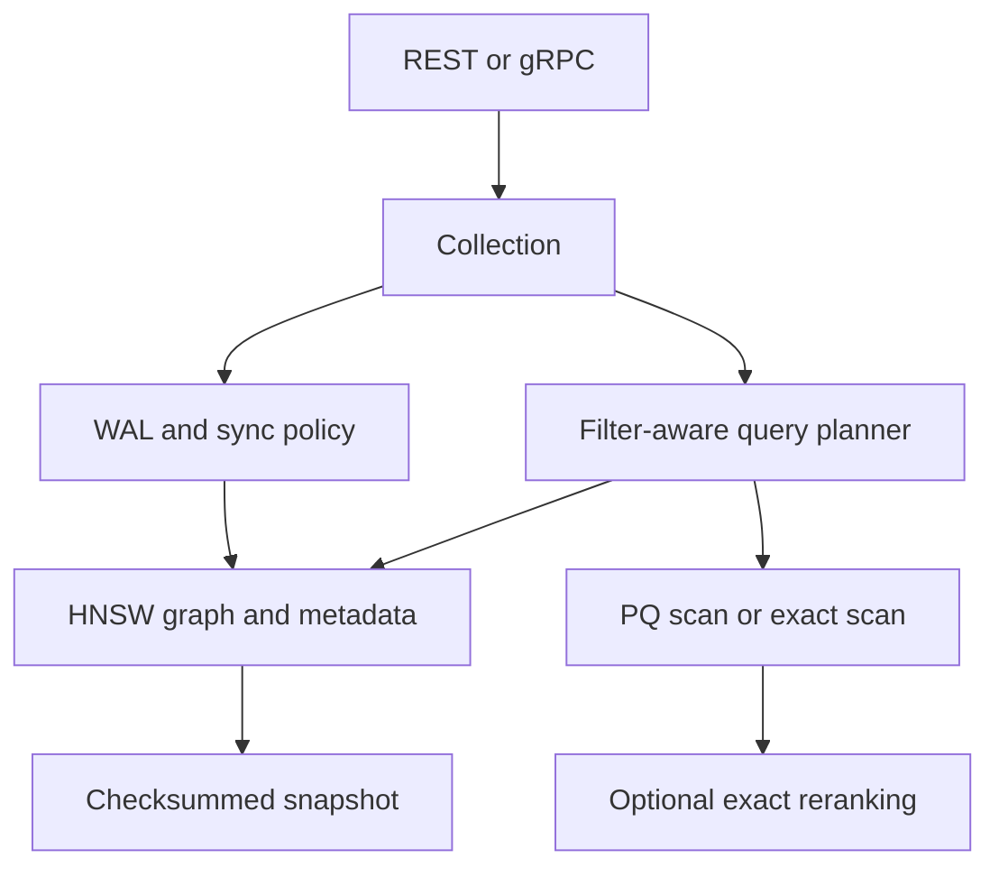

# VectorDB

**Rust · HNSW · Product quantization · SIMD · REST / gRPC**

A persistent approximate-nearest-neighbor engine that combines **vector-search algorithms with storage and recovery behavior**.

VectorDB implements an HNSW graph, product quantization, AVX2/FMA distance kernels, metadata-aware search, a checksummed WAL, and snapshots. REST and gRPC interfaces expose collections, inserts, queries, and maintenance operations.

**Status:** locally tested with server restarts, storage fault injection, synthetic benchmarks, and a Docker smoke test. No public deployment or production-scale capacity is claimed.

[Engineering](#engineering-highlights) · [Architecture](#architecture) · [Evidence](#recorded-results) · [Run locally](#run-locally) · [Scope](#scope-and-next-steps)

## Engineering highlights

- **Filters participate in search.** Metadata predicates are evaluated during traversal; a selectivity estimate chooses an exact scan for very narrow filters.
- **Durability is explicit.** With `--sync always`, writes are acknowledged after the WAL sync boundary, then recovered through snapshots and replay.
- **Compression has a defined target.** PQ reduces code storage; exact reranking retains original vectors and therefore does not imply an equal reduction in total memory.
- **The distance hot path is inspectable.** SIMD kernels have reference comparisons, while graph and filter behavior have property tests.
- **Maintenance is part of the API.** Snapshots, index rebuilds, and PQ training expose operational costs rather than hiding them.

## Architecture



Each collection has one writer and concurrent searches. The selectivity planner is a fixed heuristic, not a learned optimizer. Snapshot/rebuild operations trade query availability and peak memory for implementation simplicity.

## Recorded results

From [benchmarks](docs/benchmarks.md): 100,000 synthetic low-rank vectors, 128 dimensions, HNSW M = 16, efConstruction = 200, one search thread on a 4-vCPU host.

| efSearch | Recall@10 | VectorDB QPS | FAISS QPS |
|---|---:|---:|---:|
| 16 | 0.977 | 9,366 | 10,999 |
| 32 | 0.996 | 5,485 | 7,886 |
| 64 | 0.9999 | 3,571 | 3,809 |

FAISS used the same source vectors and matched HNSW settings; recall differs slightly. PQ codes were 15× smaller than raw vectors, reaching 0.95 recall@10 with exact reranking. This is **code compression**, not a 15× reduction in the complete database.

The recorded suite contains 41 tests, including restart checks, WAL truncation, and injected I/O faults. These do not cover every possible physical device error.

## Run locally

Requirements: Rust 1.89+ and Cargo. From this project directory:

```bash
cargo test
cargo build --release
./target/release/vectordb serve --data ./data --http 127.0.0.1:6333 --grpc 127.0.0.1:6334 --sync always
```

In another terminal:

```bash
curl -X PUT localhost:6333/collections/demo -H 'Content-Type: application/json'   -d '{"dim":3,"metric":"cosine","m":16,"ef_construction":200,"seed":42}'
curl -X PUT localhost:6333/collections/demo/points -H 'Content-Type: application/json'   -d '[{"id":1,"vector":[1,0,0],"metadata":{"lang":"en"}},{"id":2,"vector":[0,1,0],"metadata":{"lang":"de"}}]'
curl localhost:6333/collections/demo/search -H 'Content-Type: application/json'   -d '{"vector":[0.9,0.1,0],"k":1,"filter":{"eq":["lang","en"]}}'
```

The result should select point 1; exact latency depends on the host. Stop the server before running offline consistency checks against the same directory.

## Read the implementation

| Start here | What to inspect |
|---|---|
| [`src/hnsw.rs`](src/hnsw.rs) | HNSW construction and traversal |
| [`src/collection.rs`](src/collection.rs) | Filter planning and collection operations |
| [`src/distance.rs`](src/distance.rs) | SIMD distance implementations |
| [`src/wal.rs`](src/wal.rs) | WAL format and durability |

## Scope and next steps

- No authentication, TLS, replication, or sharding; expose it only through a trusted boundary.
- Single-threaded ingestion; rebuild/PQ training block searches, and snapshots can temporarily double memory usage.
- Selective filtered search can be slow near the planner threshold. Tombstones remain until rebuild.
- Benchmarks use synthetic datasets and one host. Fault coverage does not include real device EIO or every fsync-failure scenario.
- Next priorities: real embedding datasets, incremental maintenance, stronger storage-fault coverage, and measured ingestion scaling.

## Documentation

- [Benchmark methodology](docs/benchmarks.md)
- [Testing](docs/testing.md)
- [Adversarial audit](docs/audit.md)
- [Security boundary](docs/security.md)
- [Limitations](docs/limitations.md)
